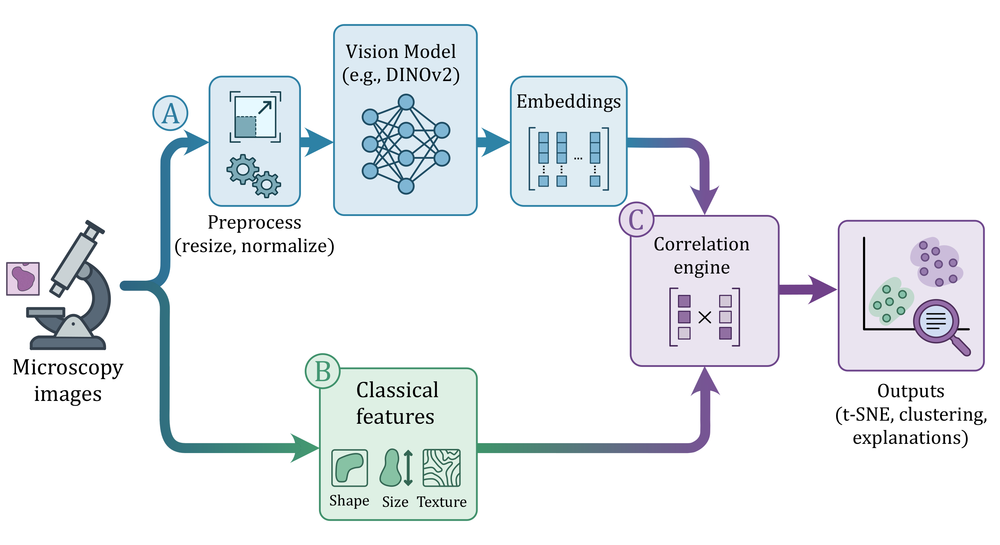

## Package layout

| Area | Path | Role |
|------|------|------|
| Orchestrator | `phenome.pipeline` | `PhenoMe` class; user-facing workflow. |
| Mixins | `phenome.mixins` | Behaviour split into dataset, embeddings, properties, distances, analysis, visualization, interactive. |
| Core algorithms | `phenome.core` | DR, correlation, interpretability, results container (`PhenoMeResults`), export, validation. |
| I/O | `phenome.io` | Images, checkpoints, file discovery. |
| Metadata | `phenome.metadata` | `MetadataBase` and concrete extractors. |
| Utilities | `phenome.utils` | Model wrappers, transforms, metadata helpers, property factories. |
| Plugins | `phenome.plugins` | Registries for properties, metadata extractors, report sections. |
| Report | `phenome.report` | HTML report generation. |

Imports for users are mostly from **`phenome`** (re-exports). See the
[Function location guide](/PhenoMe/function-location-guide/) for a full symbol
index.

## How the source is split

`PhenoMe` (`phenome/pipeline.py`) is the session: the file table, embeddings,
properties, the open checkpoint, and the run log. It inherits one mixin per
capability and calls the packages below. Scientists import from `phenome`;
`phenome/__init__.py` only re-exports that public surface. A module whose
name starts with `_` is package-private.

| Area | How the files are split |
|------|-------------------------|
| Properties | `PhenoMeProperties` lives in `mixins/properties/main.py`. Computation, grouping, workers, and path handling are sibling modules (`_compute.py`, `grouping.py`, `matrix.py`, `_workers.py`, `_paths.py`). |
| Plots | `PhenoMeVisualization` in `mixins/visualization/_core.py` stacks one mixin per plot family (`_dr_plots.py`, `_image_display.py`, `_distance_plots.py`, and the correlation, enrichment, and interpretability plot modules) plus `_helpers.py`. |
| Analysis, distances, batch correction | `mixins/analysis.py`, `distances.py`, `batch_correction.py`. Analysis computes; visualization draws. |
| Interactive explorers | `mixins/interactive/`, imported when first used. Shared markup is `_html_components.py`. |
| Core | Containers and math with no session of their own: `PhenoMeResults`, the processing-pipeline record, the run log, and `core/math/`. |
| I/O | `read_image` and `FileDiscovery` in `io/discovery.py`. `CheckpointManager` in `io/checkpoint.py`, serialization in `_checkpoint_ops.py`, resume matching in `checkpoint_alignment.py`. |
| Report | `report/generator.py` assembles the page. One section per file under `report/sections/`. CSS, JavaScript, and HTML fragments are separate modules. |

## Data flow (typical run)

The typical data flow maps directly to the pipeline overview components:

1.  **Discovery (Input)** — Gather raw image paths and experimental metadata.
2.  **Embeddings (A)** — Batch inference through a `ModelWrapper` to extract visual fingerprints.
3.  **Properties (B)** — Parallel computation of classical features from images/masks.
4.  **Analysis & Visualization (C)** — Combine embeddings and properties for quantification and plotting.

## Extension points

| Goal | Where to start |
|------|----------------|
| Custom metadata from paths or tables | [Experiment details](/PhenoMe/guides/experiment-details/), `MetadataBase`, `get_metadata_from_path`, `make_dataframe_metadata_fn`. |
| Custom image features | [Select properties](/PhenoMe/guides/select-properties/), `phenome.plugins.register_property`. |
| Custom vision backbone | [Model wrapper API](/PhenoMe/advanced/api/model-wrapper/); subclass `ModelWrapper`. |
| Report sections | [Extending PhenoMe](/PhenoMe/guides/extending/), `register_report_section`. |

**Rule of thumb:** prefer hooks (`metadata_fn`, property factories,
plugins) before forking `PhenoMe` internals.

## Where should I add code?

A public method stays the sequence a reader can follow: check inputs, call the
computation, store the result, log the step. The formula, the figure, and the
array reshaping go in a sibling module. Properties and visualization are the
pattern to copy. Name the file for that one job.

A module of a few hundred lines is the normal size. Move helpers out before
adding another large function. `pipeline.py`, `mixins/interactive/explorer.py`,
`mixins/analysis.py`, `io/checkpoint.py`, `core/processing_pipeline.py`, and
`mixins/properties/_compute.py` already hold whole subsystems. New behavior
there is a new module those files call.

| Adding... | Prefer |
|-----------|--------|
| A workflow step that needs the session | The mixin for that step. A new capability is a new mixin on `class PhenoMe`. |
| Math on arrays (DR, correlation, stats) | `phenome/core/math/`. |
| Images, paths, HDF5 | `phenome/io/`. |
| A plot | A new `_*.py` mixin under `mixins/visualization/`, composed in `_core.py`. |
| A classical image feature | `phenome/utils/property_factories.py`, or `phenome/plugins` when users register it. |
| A block of the HTML report | `phenome/report/sections/`. |
| Metadata from a path or a table | `phenome/metadata/`. |
| A name users import | Re-export it from `phenome/__init__.py`. |

Public functions and classes use NumPy-style docstrings (quantity, array shape,
conditions). The API pages are generated from those docstrings. See the
[Developer guide](/PhenoMe/guides/developer-guide/).

## Further reading

- [HDF5 protocol](/PhenoMe/advanced/database_protocol/).
- [API & data formats](/PhenoMe/advanced/).
- [Developer guide](/PhenoMe/guides/developer-guide/).
